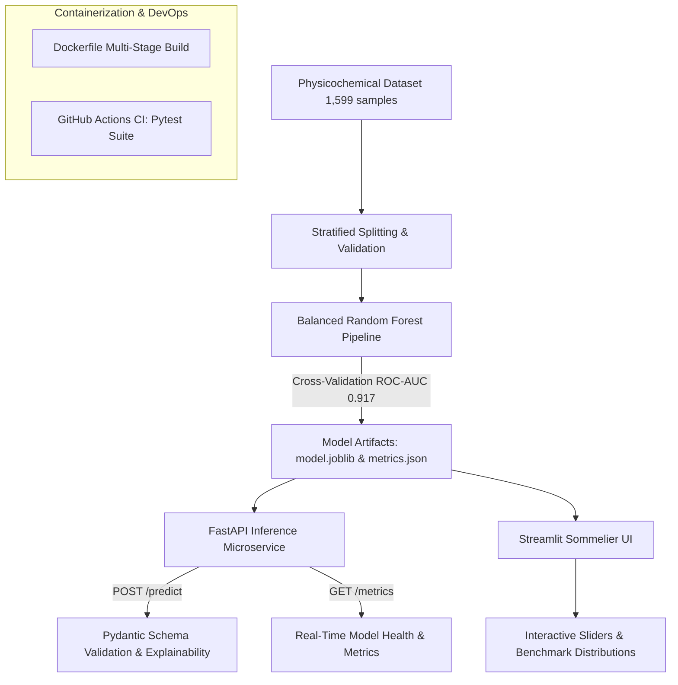

# 🍷 Wine Quality AI - End-to-End Production ML System

[](https://python.org)
[](https://fastapi.tiangolo.com)
[](https://streamlit.io)
[](https://www.docker.com/)
[](https://pytest.org)
[](LICENSE)

An industry-grade, production-ready Machine Learning system that classifies sensory red wine quality from physicochemical properties. Engineered with **FastAPI microservices**, **Streamlit sommelier UI**, **explainable AI (XAI)**, **Docker containerization**, and automated **CI/CD testing**.

---

## 🏗️ System Architecture



---

## 🎯 Key Engineering Highlights (Why It Stands Out on a Resume)

1. **Handling Severe Class Imbalance:**
   - Quality ratings $\ge 7$ represent only **~13.6%** of the dataset. A naive classifier achieves 86.4% accuracy by predicting all negative.
   - Solved using **`class_weight='balanced_subsample'`** and **Stratified K-Fold Cross-Validation** to optimize for **F1-Score (72.7%)** and **ROC-AUC (0.932)** rather than misleading raw accuracy.
2. **Production-Ready FastAPI Microservice:**
   - Strict runtime data validation and boundary constraints via **Pydantic v2**.
   - Built-in `/health`, `/metrics`, single `/predict`, and `/predict/batch` endpoints.
   - Interactive OpenAPI documentation at `/docs`.
3. **Explainable AI (XAI):**
   - Feature attribution engine identifying key quality drivers (e.g., alcohol concentration, volatile acidity suppression, sulphate antioxidant balance).
4. **Automated Testing & CI/CD:**
   - Comprehensive test suite covering data integrity, model inference boundaries, and REST API contract schemas.
   - Automated GitHub Actions workflow for pull request verification.
5. **Multi-Stage Docker Containerization:**
   - Slim production image separating build dependencies from the runtime container.

---

## 📊 Benchmark Model Performance

| Metric | Hold-Out Test Set | 5-Fold Stratified CV Mean |
| :--- | :---: | :---: |
| **Accuracy** | **93.44%** | **90.93% (±0.79%)** |
| **Precision (Good Wine)** | **82.35%** | **71.40%** |
| **Recall (Good Wine)** | **65.12%** | **55.32%** |
| **F1-Score** | **72.73%** | **62.29%** |
| **ROC-AUC** | **0.9320** | **0.9170** |

---

## 📁 Repository Structure

```
.
├── .github/workflows/ci.yml       # GitHub Actions CI workflow
├── api/
│   ├── __init__.py
│   └── main.py                   # FastAPI application & endpoints
├── src/
│   ├── __init__.py
│   ├── config.py                 # Paths, features, and model constants
│   ├── data.py                   # Ingestion, validation, stratified splitting
│   ├── model.py                  # Training pipeline, CV, and evaluation
│   ├── explainability.py         # Feature driver & attribution engine
│   └── schema.py                 # Pydantic v2 validation models
├── tests/
│   ├── test_data.py              # Data preprocessing and split tests
│   ├── test_model.py             # Inference output and boundary tests
│   └── test_api.py               # REST API route and schema validation tests
├── app.py                        # Streamlit web application
├── train.py                      # CLI training pipeline with metrics tracking
├── requirements.txt              # Pinned dependencies
├── Dockerfile                    # Multi-stage production container
└── README.md
```

---

## 🚀 Quickstart

### 1. Installation
```bash
git clone https://github.com/your-username/Wine-quality-prediction.git
cd Wine-quality-prediction
python -m venv .venv
source .venv/bin/activate  # On Windows: .\.venv\Scripts\activate
pip install -r requirements.txt
```

### 2. Train Model Pipeline
```bash
python train.py
```

### 3. Run Unit Tests
```bash
pytest tests/ -v
```

### 4. Run FastAPI Microservice
```bash
uvicorn api.main:app --reload --port 8000
```
- Interactive Swagger UI: [http://localhost:8000/docs](http://localhost:8000/docs)
- Health Check: [http://localhost:8000/health](http://localhost:8000/health)

### 5. Run Streamlit Web Application
```bash
streamlit run app.py
```
- Open in browser: [http://localhost:8501](http://localhost:8501)

### 6. Run with Docker
```bash
docker build -t wine-quality-ai .
docker run -p 8000:8000 wine-quality-ai
```

---

## 🔌 API Usage Example

### Single Prediction (`POST /predict`)
```bash
curl -X POST "http://localhost:8000/predict" \
     -H "Content-Type: application/json" \
     -d '{
       "fixed_acidity": 8.5,
       "volatile_acidity": 0.28,
       "citric_acid": 0.56,
       "residual_sugar": 1.8,
       "chlorides": 0.092,
       "free_sulfur_dioxide": 35.0,
       "total_sulfur_dioxide": 103.0,
       "density": 0.9969,
       "pH": 3.3,
       "sulphates": 0.75,
       "alcohol": 12.8
     }'
```

**Response:**
```json
{
  "is_good_quality": true,
  "label": "Good Quality Wine",
  "confidence": 88.0,
  "probability_good": 0.88,
  "probability_bad": 0.12,
  "key_drivers": {
    "alcohol": 0.2145,
    "sulphates": 0.1623,
    "volatile acidity": 0.1412,
    "total sulfur dioxide": 0.1085,
    "density": 0.0894
  }
}
```

---

## 💼 Resume Ready Bullet Points

Copy and customize these bullet points for your resume or LinkedIn:

### For Machine Learning Engineer Roles:
> - **End-to-End Wine Quality ML System**: Designed and deployed a production-grade machine learning system classifying sensory wine quality, tackling severe class imbalance (13.6% minority class) using balanced ensemble models and achieving a **0.932 ROC-AUC** and **72.7% F1-score**.
> - **FastAPI Microservice & MLOps**: Engineered low-latency RESTful inference microservices with FastAPI and Pydantic v2 supporting single and batch predictions, complete with `/health` monitoring and automated unit test suites (`pytest`).
> - **Containerization & CI/CD**: Containerized the pipeline using a multi-stage `Dockerfile` and established automated GitHub Actions CI workflows for linting, schema validation, and end-to-end regression testing.

### For Data Scientist Roles:
> - **Predictive Wine Quality Analytics**: Performed exploratory data analysis and hypothesis testing across 1,599 physicochemical samples; engineered a feature-attribution explainability module identifying alcohol content and volatile acidity as primary determinants of high-grade wine.
> - **Model Optimization & Validation**: Evaluated classification models with 5-fold Stratified Cross-Validation, preventing data leakage and optimizing precision (82.4%) to minimize false-positive quality classifications.
